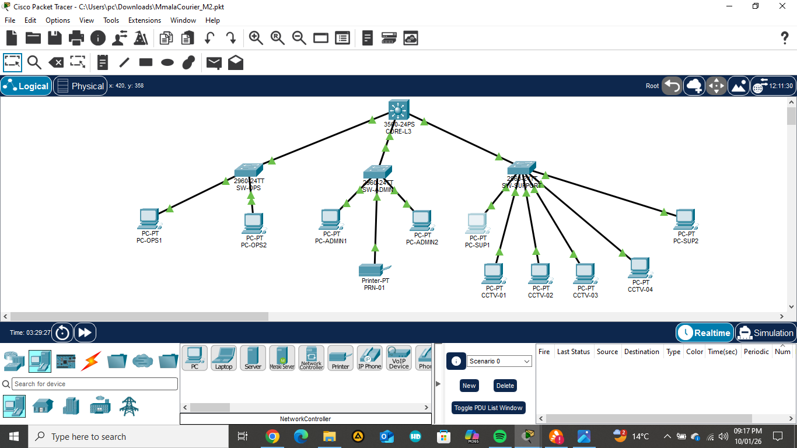

# CMPG325 – Mmala Courier Services Network Project

Individual semester project for **CMPG 325 (Computer Networks)**, North-West University.

| | |
|---|---|
| Student | Mandelisa, Thato (34286799) |
| Project ID | CMPG325-2026-045 |
| Client | CLI-045 – Mmala Courier Services (Rustenburg), Logistics |
| Assigned challenge | Inter-VLAN Routing (L3 switch / SVI) |
| Addressing block | 172.30.22.0/23 |
| Design constraint | Printer sharing must cross departments, file sharing must not |
| Change request | CR7 – four CCTV cameras are added and their traffic must be segmented |

## Project overview

This repository documents the design, configuration and testing of a segmented VLAN network for Mmala Courier Services, built and simulated in Cisco Packet Tracer. A Layer 3 switch (CORE-L3) routes between five VLANs using SVIs, and extended ACLs enforce the client's rules: printers reachable from every department, file sharing kept inside each department, and CCTV traffic segmented (CR7).

## Navigation

- [Client requirements](Client%20Requirements.md)
- [IP addressing plan](IP-Addressing-Plan.md)
- Physical topology (Milestone 1): [physical-topology.png](physical-topology.png)
- Logical topology (Milestone 1): [logical-topology.png](logical-topology.png)
- Packet Tracer file: [MmalaCourier_M2.pkt](MmalaCourier_M2.pkt) (open with Cisco Packet Tracer)
- Evidence screenshots: [see the evidence index below](#evidence-index)

## Design summary

| Device | Role |
|---|---|
| CORE-L3 (3560-24PS) | Core multilayer switch: VLANs, 802.1Q trunks, SVIs, ACLs |
| SW-OPS (2960) | Access switch, Courier Operations (VLAN 10) |
| SW-ADMIN (2960) | Access switch, Administration (VLAN 20) and printer PRN-01 (VLAN 40) |
| SW-SUPPORT (2960) | Access switch, Support (VLAN 30) and four CCTV devices (VLAN 50) |

| VLAN | Name | Subnet | Gateway (SVI) |
|---|---|---|---|
| 10 | Courier Operations | 172.30.22.0/25 | 172.30.22.1 |
| 20 | Administration | 172.30.22.128/26 | 172.30.22.129 |
| 30 | Support | 172.30.22.192/26 | 172.30.22.193 |
| 40 | Printer | 172.30.23.0/27 | 172.30.23.1 |
| 50 | CCTV | 172.30.23.32/28 | 172.30.23.33 |

Full plan, including end-device addresses: [IP-Addressing-Plan.md](IP-Addressing-Plan.md).

**Correction to Milestone 1:** the Milestone 1 plan listed the Printer and CCTV subnets as 172.30.22.256/27 and 172.30.22.288/28. Those are invalid (an octet cannot exceed 255). Because the /23 continues into 172.30.23.0, they were moved to 172.30.23.0/27 and 172.30.23.32/28 in Milestone 2.

## How the requirements are met

- **Inter-VLAN routing (assigned challenge):** `ip routing` on CORE-L3 with one SVI per VLAN. Routing happens inside the switch, so no external router is needed for a single-site client.
- **Printer shared, files not:** extended ACLs applied inbound on each department SVI permit traffic to the printer subnet and deny traffic to the other departments. Packet Tracer cannot run real file sharing, so a blocked ping between departments is the evidence.
- **CR7 (CCTV):** the cameras sit on their own VLAN 50. Department ACLs deny traffic into it, and a `CCTV-IN` ACL on VLAN 50 stops the cameras initiating traffic to the rest of the /23. Cameras can still reach each other inside VLAN 50.

## Evidence index

| # | Evidence | File |
|---|---|---|
| 00 | Full topology | [00-topology.png](00-topology.png) |
| 01 | show vlan brief – SW-OPS | [01-vlan brief sw-ops.png](01-vlan%20brief%20sw-ops.png) |
| 02 | show vlan brief – SW-ADMIN | [02-vlan brief sw-admin.png](02-vlan%20brief%20sw-admin.png) |
| 03 | show vlan brief – SW-SUPPORT | [03-vlan brief sw-support.png](03-vlan%20brief%20sw-support.png) |
| 04 | Trunk – SW-ADMIN | [04-trunk-sw-admin.png](04-trunk-sw-admin.png) |
| 05 | Trunk – SW-SUPPORT | [05-trunk-sw-support.png](05-trunk-sw-support.png) |
| 06 | Trunks – CORE-L3 | [06-inter-trunk core-l3.png](06-inter-trunk%20core-l3.png) |
| 07 | Ops to Admin ping (before ACLs) | [07-ping ops to admin.png](07-ping%20ops%20to%20admin.png) |
| 08 | Ops to printer ping (before ACLs) | [08-ping ops to printer.png](08-ping%20ops%20to%20printer.png) |
| 09 | Admin to printer ping (before ACLs) | [09- ping_admin_to_printer.png](09-%20ping_admin_to_printer.png) |
| 10 | Support to printer ping (before ACLs) | [10-ping_support_to_printer.png](10-ping_support_to_printer.png) |
| 11 | Ops to camera ping (before ACLs) | [11-ping_ops_to_cctv-BEFORE-acl.png](11-ping_ops_to_cctv-BEFORE-acl.png) |
| 12 | show ip interface brief – CORE-L3 | [12-ip_interface_brief_core.png](12-ip_interface_brief_core.png) |
| 13 | show ip route – CORE-L3 | [13-ip_route_core.png](13-ip_route_core.png) |
| 14 | Ops to Admin blocked (after ACLs) | [14-ping_ops_to_admin_blocked.png](14-ping_ops_to_admin_blocked.png) |
| 15 | Ops to printer works (after ACLs) | [15-ping_ops_to_printer_AFTER_acl.png](15-ping_ops_to_printer_AFTER_acl.png) |
| 16 | Ops to camera blocked (after ACLs) | [16-ping_ops_to_cctv-after_acl.png](16-ping_ops_to_cctv-after_acl.png) |
| 17 | Support to printer works (after ACLs) | [17-ping_support_to_printer_AFTER-acl.png](17-ping_support_to_printer_AFTER-acl.png) |
| 18 | show access-lists with match counts | [18-access_list_with_matches.png](18-access_list_with_matches.png) |
| 19 | Admin to Ops blocked | [19-ping_admin_to_ops_-BLOCKED.png](19-ping_admin_to_ops_-BLOCKED.png) |
| 20 | Admin to printer works (after ACLs) | [20-ping_admin_to_printer_AFTER-acl.png](20-ping_admin_to_printer_AFTER-acl.png) |
| 21 | CCTV to Ops blocked | [21-ping_cctv_to_ops_BLOCKED.png](21-ping_cctv_to_ops_BLOCKED.png) |
| 22 | CCTV to CCTV works (same VLAN) | [22-ping_cctv_to_cctv.png](22-ping_cctv_to_cctv.png) |

## Troubleshooting log (summary)

- Gi0/3 does not exist on the 3560-24PS, so the third uplink uses Fa0/3.
- SW-ADMIN uplink was on Gi0/2, not Gi0/1, so the trunk was moved to the port actually cabled.
- STP "inconsistent port type" message cleared once both ends of the link were trunks.
- Configuration lost after a restart because the .pkt was not saved; now saved after every step.
- First ping of each test times out while ARP resolves; repeated pings for clean evidence.
- One CCTV test pinged the camera's own IP (proves nothing); repeated against a different camera.

## Milestones

- Project commencement: 14 August 2026
- Milestone 1: 28 August 2026 – requirements, topology, addressing plan
- Milestone 2: 2 October 2026 – Packet Tracer implementation, ACLs, testing
- Final submission: 16 October 2026

## How to open the project

Install Cisco Packet Tracer, open the .pkt file linked above, and use the CLI on CORE-L3 (`show ip interface brief`, `show ip route`, `show access-lists`) to verify the configuration.
